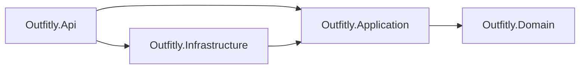
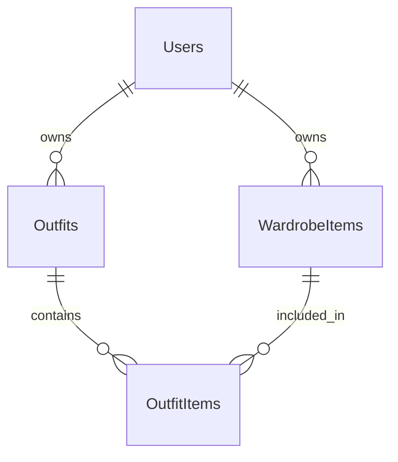
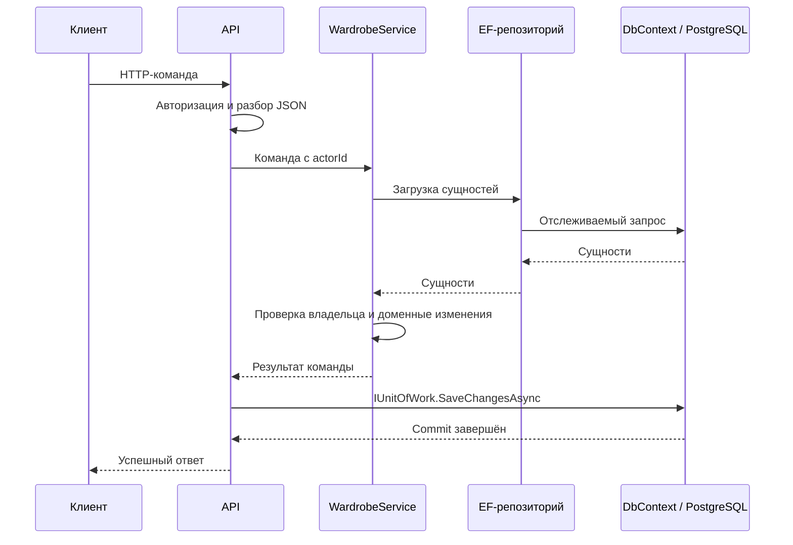

# Архитектура проекта

Этот документ объясняет ответственность слоёв и важные ограничения.

## Назначение и состояние

Outfitly — учебное приложение для личного гардероба: вещи по категориям,
их характеристики, составление образов и доступ к вещам/образам по ссылке.
Первая версия ограничена этими сценариями.

Backend реализован на .NET 10: доменная модель, use cases, EF Core/PostgreSQL
и базовый HTTP API. Frontend — адаптивный интерфейс HTML/CSS/JavaScript без фреймворка;
страницы гардероба, образов, авторизации, публикации и ссылок подключены к API.

Аутентификация реализована через email/пароль и защищённую cookie с сессией в БД.
Защищённые маршруты требуют действующей сессии. Публичные списки и активные ссылки
доступны анонимно при настроенной БД. Новые аккаунты требуют подтверждения email;
восстановление пароля реализовано для подтверждённых аккаунтов.

## Структура и зависимости

```text
src/backend/
  Outfitly.Domain/          # Сущности и доменные правила
  Outfitly.Application/     # Use cases, порты, DTO
  Outfitly.Infrastructure/  # EF, PostgreSQL, миграции
  Outfitly.Api/             # HTTP, авторизация, DI
src/frontend/              # HTML/CSS/JavaScript
tests/backend/Outfitly.Tests/{Domain,Application,Infrastructure,Api}/
tests/frontend/
docs/
```

Стрелка означает зависимость проекта, а не направление выполнения запроса.



| Слой | Ответственность | Что не размещаем |
| --- | --- | --- |
| Domain | User, WardrobeItem, Outfit, ShareLink; валидация и переходы состояния | EF, HTTP, identity, DI |
| Application | WardrobeService; владение, выбор ресурсов, координация удаления; IWardrobeRepository, IUnitOfWork, DTO | DbContext, SQL, маршруты и HTTP-коды |
| Infrastructure | EfWardrobeRepository, OutfitlyDbContext, конфигурации и миграции; реализация портов | HTTP-ответы и бизнес-сценарии |
| Api | Контракты запросов, серверная identity, политики, маршруты, commit filter, ProblemDetails; composition root | Дублирование доменных правил, OwnerId из тела запроса |

Infrastructure использует доменные типы через транзитивную зависимость
Application → Domain. Domain не зависит от других слоёв. Frontend взаимодействует
с backend по HTTP; правила гардероба выполняются на сервере.

## Доменная модель

| Сущность | Данные и назначение |
| --- | --- |
| User | ID владельца и отображаемое имя; без учётных данных |
| WardrobeItem | Владелец, имя, категория, цвет, размер, бренд, описание, URL фото, публикация |
| Outfit | Владелец, имя, описание, публикация, состав из вещей владельца |
| ShareLink | Уникальный токен, тип/ID цели, активность |

Категории заданы enum `ClothingCategory`, отдельной сущности категории нет.
Идентификаторы задаются приложением. Обязательные имена нормализуются и не могут
быть пустыми; пустые необязательные поля становятся `null`.
Фото задаётся внешним абсолютным HTTP/HTTPS URL либо ключом загруженного файла;
эти источники взаимоисключающие. Файловые ключи не раскрываются в HTTP-представлениях.

Образ содержит только вещи своего владельца без дубликатов по ID.
Пустой черновик разрешён, публикация и создание ссылки для него запрещены.
Публикация и ссылки независимы: снятие публикации не отзывает ссылку.
Опубликованный/расшаренный образ показывает приватные вещи в своём контексте,
но не публикует их отдельно.

Удаление вещи убирает её из всех образов и отзывает ссылки на вещь.
Опустевшие образы становятся приватными, их ссылки отзываются.
Удаление образа сохраняет вещи и отзывает ссылки на образ.
Повторное заполнение не восстанавливает старые ссылки.

## Хранение

EF-маппинги находятся в Infrastructure, без EF-атрибутов в Domain.
Таблицы гардероба: Users, WardrobeItems, Outfits, OutfitItems и ShareLinks.
Учётные данные и сессии хранятся отдельно в Accounts и LoginSessions.



OutfitItems — таблица связи, а не отдельная доменная сущность.
Ключ `(OutfitId, WardrobeItemId)` запрещает повтор вещи. Оба внешних ключа
включают OwnerId и запрещают связывать вещи/образы разных владельцев.
Удаление образа каскадно удаляет связи; удаление ещё используемой вещи
и владельца с гардеробом ограничено внешними ключами.

Enum хранятся строками. Токен ссылки имеет уникальный индекс и восстанавливается
без повторной генерации. Полиморфная цель ShareLink не имеет внешнего ключа:
доступность и отзыв проверяет Application. Отозванные ссылки сохраняются.

## Запрос и граница сохранения



Это путь успешной команды гардероба после проверки cookie, сессии, авторизации и CSRF.

WardrobeService, репозиторий и DbContext имеют scoped lifetime.
IUnitOfWork зарегистрирован как тот же DbContext. CommitChangesFilter применяется
только к командам и сохраняет изменения перед успешным ответом.
При исключении или ошибочном результате команды commit не выполняется.
Удаление вещи, обновление образов и отзыв ссылок сохраняются одной транзакцией EF.

Команды над образом вызывают `IWardrobeRepository.MarkOutfitChanged`, включая
изменение состава, публикации, создание/отзыв ссылок и удаление вещи из образа.
EF обновляет shadow-поле `Outfits.Revision` и сравнивает его с версией первого
чтения. Устаревшая команда откатывается целиком с `WardrobeConcurrencyException`;
API возвращает `409`. Для повторения нужен новый scope и повторное чтение/проверка,
а не повтор SaveChanges на старых объектах. Domain не зависит от механизма версий.

EF отслеживает изменения через доменные методы. Репозиторий учитывает pending additions
и исключает pending deletions. После ошибки сохранения scope завершается:
откат БД не восстанавливает состояние объектов в памяти.

OwnerId берётся из ClaimTypes.NameIdentifier с непустым Guid. Application дополнительно
проверяет владельца ресурса. Регистрация создаёт доменного User вместе с учётными данными.
HTTP возвращает DTO, а не сущности. Владелец получает токены при создании и просмотре
своих активных ссылок. В контексте общей ссылки URL фото содержит тот же токен;
личные и публичные просмотры токены не раскрывают. Ошибки возвращаются как ProblemDetails.
Точные маршруты описаны в [README API](../src/backend/Outfitly.Api/README.md).

Текущий DTO-контракт включает OwnerId; запрет раскрытия этого поля не установлен.

## Проверки и ограничения

Domain/Application проверяются через публичное поведение без моков БД.
Реляционные тесты используют изолированную SQLite; HTTP-тесты — реальный pipeline
через WebApplicationFactory. PostgreSQL-тесты применяют миграции в отдельных схемах
и явно пропускаются без тестовой строки подключения.
Подробнее — [стратегия тестирования](../tests/backend/Outfitly.Tests/README.md).

Командный репозиторий синхронный и загружает коллекции целиком. Каталог вещей использует
отдельный Application-порт `IItemCatalogQuery`: EF выполняет асинхронные фильтры,
подсчёт и пагинацию в PostgreSQL без отслеживания. API не применяет миграции автоматически.
DTO образов используют один lookup вещей на операцию, без повторных запросов для
каждого вхождения вещи. CI запускает все тесты с настоящим PostgreSQL.
Собранный frontend раздаётся API с того же HTTPS origin; интерфейс использует
относительные API URL, серверную cookie и CSRF для изменяющих запросов.
Эксплуатационная инфраструктура остаётся за рамками версии.

## Загруженные фотографии

Application координирует владение, обработку и хранение через `PhotoService`,
`IPhotoProcessor`, `IPhotoStore` и scoped `PhotoChanges`. Infrastructure декодирует
и перекодирует изображения и хранит файлы отдельно от PostgreSQL и публичного web root.
API формирует URL под контекст просмотра; Application проверяет владельца, публикацию
или активную ссылку и членство вещи в образе при каждом чтении фото.

Новый файл записывается до commit БД. `CommitChangesFilter` при ошибке удаляет новые
файлы, после успеха — заменённые; удаление вещи и переход на внешний URL используют
тот же механизм. Ошибки очистки логируются и не отменяют сохранённую команду.
EF проверяет исходный `PhotoStorageKey` как concurrency token при UPDATE/DELETE;
конфликт даёт `WardrobeConcurrencyException`, повтор возможен только в новом scope.
Файловая система и БД не образуют общей транзакции: аварийное завершение процесса
может оставить неиспользуемый файл. Фоновая очистка пока не реализована.

## Учётные данные и сессии

AccountService в Application координирует регистрацию, проверку пароля и отзыв сессии;
IAccountStore и IAccountPasswordHasher не зависят от EF/HTTP. Infrastructure реализует
хранение на том же scoped DbContext и хеширование стандартным PasswordHasher.
Domain.User содержит только ID и имя. EF-маппинги аккаунта/сессии остаются в Infrastructure.

AccountService также выдаёт и проверяет одноразовые токены подтверждения email.
В Accounts хранится только SHA-256 токена; исходный токен передаётся порту
IConfirmationEmailSender, который реализован SMTP-адаптером Infrastructure.
Хеш служит concurrency token: подтверждение и повторная выдача проверяют исходное
состояние записи, конфликт откатывает команду. Вход и проверка каждой сессии требуют
подтверждённого аккаунта. Миграция сохраняет доступ существующим аккаунтам.
API сохраняет аккаунт/токен одним commit, затем отправляет письмо. SMTP и БД не образуют
общей транзакции; сбой или остановка после commit требуют повторной отправки пользователем.
Очередь и фоновые повторы не реализованы. Сроки и HTTP-ответы описаны в API README.

Регистрация сохраняет User и Account одной транзакцией. Уникальный нормализованный email
защищён индексом PostgreSQL; конфликт этого индекса преобразуется в AccountConflictException.
Старые Users автоматически не получают учётных данных. Сессия ссылается на Account,
а тот — на User. При проверке сессии требуется существование всех трёх записей.

Api создаёт защищённый ticket с ID пользователя и случайным ID сессии. Каждый запрос
проверяет срок и отзыв сессии через Application. Выход отзывает только текущую сессию;
вход в уже авторизованном браузере заменяет и отзывает предыдущую сессию.
Auth-команды явно выполняют один IUnitOfWork.SaveChangesAsync до SignIn/SignOut;
CommitChangesFilter на них не применяется. Ошибка сохранения завершает scope.
CSRF проверяется после авторизации и до выполнения изменяющей операции.

HTTP-контракты и сроки описаны в [API](../src/backend/Outfitly.Api/README.md),
HTTPS и ключи Data Protection — в [разработке](development.md).

Сброс пароля использует отдельный одноразовый токен с SHA-256 в Accounts и тот же
порт отправки писем (назначение Confirmation/PasswordReset). Выдача сохраняется до
отправки; сброс атомарно меняет хеш пароля, погашает токен и отзывает сессии.
PasswordHash и PasswordResetTokenHash — concurrency tokens. Вход включает проверку
исходного хеша пароля в commit. SessionVersion аккаунта меняется при сбросе и
сравнивается с версией сессии при каждом запросе: это закрывает гонку входа с отзывом
сессий. Существующие аккаунты/сессии получают одинаковую нулевую версию миграцией.
